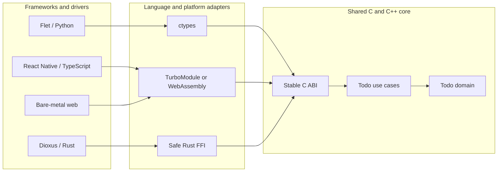

# Todo — one domain, native experiences

Todo is a cross-platform Clean Architecture example. A framework-free C++20
domain is exported through a stable C ABI and reused by Python/Flet,
TypeScript/React Native, Rust/Dioxus, and a bare-metal web interface.

The point is not “write once, test once.” Cross-platform software needs people
who understand every target and a build/test gate on every target. This model
fits teams that can sustain that matrix; it is usually too costly for a very
small team. In return, domain migrations stay easy, UI and UX can follow the
brand on each platform, and UI frameworks can be replaced without rewriting
business rules.

## Solution architecture



Dependencies point inward. The core never imports a UI, operating system, or
storage framework. Adapters own all conversion, allocation, and FFI concerns.

## SOLID in practice

- **S**: `TodoList` owns Todo rules; presenters own rendering.
- **O**: another UI implements the port without changing the core.
- **L**: native, WebAssembly, fake, and FFI adapters run contract tests.
- **I**: UIs see only add, toggle, remove, and list capabilities.
- **D**: presenters depend on the Todo port, not on FFI or a framework.

## Repository map

```text
apps/               Flet, React Native, Dioxus, and bare web UIs
bindings/           Python, TypeScript, and Rust language adapters
core/               C ABI, C++ domain, use cases, and memory adapter
tests/              unit, functional, integration, and E2E checks
brand/              source artwork and platform application icons
docs/               architecture, runbooks, and verification reports
plans/              ordered implementation and rollout plans
specs/              domain contracts and four-tier test matrix
tasks/              pending and completed task ledger
memories/           durable agent context and decisions
```

## Target support

| Target | Example path | Verification owner |
| --- | --- | --- |
| Web | bare web, Flet web, Dioxus web | Linux CI browser gate |
| macOS | Flet and Dioxus desktop | macOS CI |
| Linux | Flet and Dioxus desktop | Linux CI |
| Windows | Flet and Dioxus desktop | Windows CI |
| iOS | React Native, Flet, Dioxus | macOS CI and simulator |
| Android | React Native, Flet, Dioxus | Linux CI and emulator |

React Native desktop/web platforms are optional extensions. The monorepo as a
whole covers all six targets; it does not claim every UI framework supports
every target.

## Build and test

Native core without third-party test libraries:

```sh
cmake -S . -B build -DCMAKE_BUILD_TYPE=Debug
cmake --build build --parallel
ctest --test-dir build --output-on-failure
```

Language and UI commands are documented beside each application. The complete
matrix and acceptance boundary are in [the test matrix](specs/test-matrix.md).

## Brand

The supplied checkmark-document assets are preserved in `brand/`. Todo uses
navy `#183453`, coral `#FF867C`, rose `#F68A90`, blue `#31B4F1`, and cream
`#FFF6DB` without stretching or recoloring the master logo.

## Verification status

Passing a host build proves only that host. The repository records each target
as implemented, compiled, simulator-tested, or device-tested. No mobile release
claim is made without the matching SDK and target test evidence.

