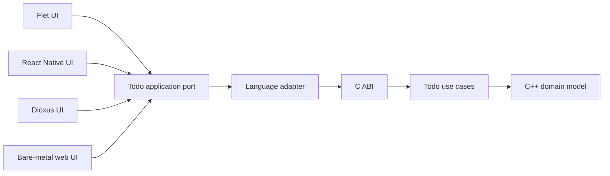
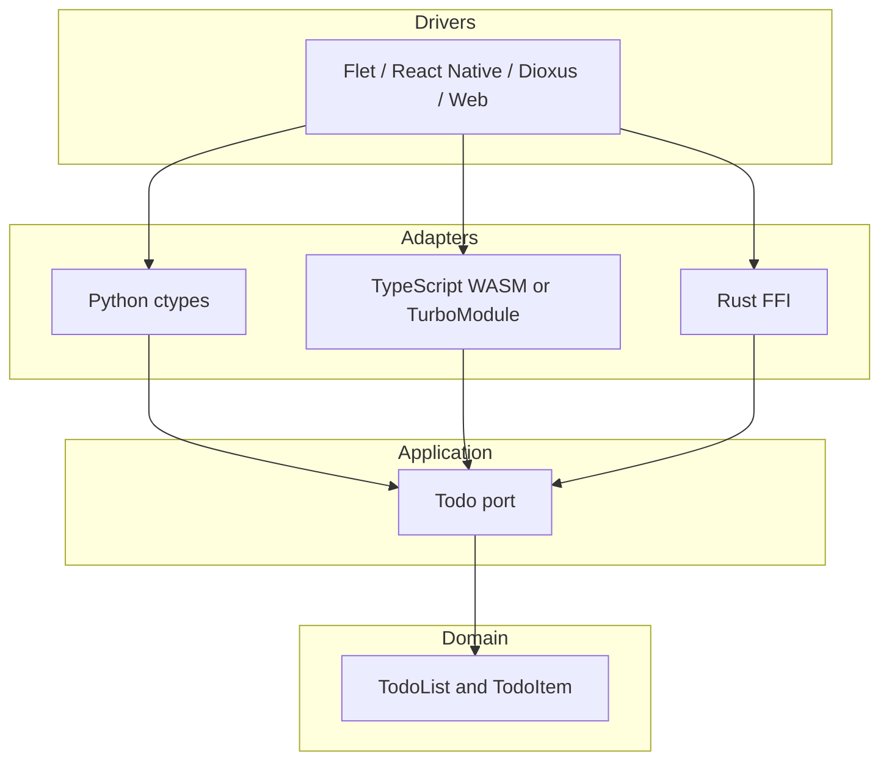

# Todo Solution Architecture

Dependencies point inward. The framework-facing applications translate user
events into application-port calls. Language adapters translate values and
ownership across the C ABI. The core alone enforces Todo invariants.

